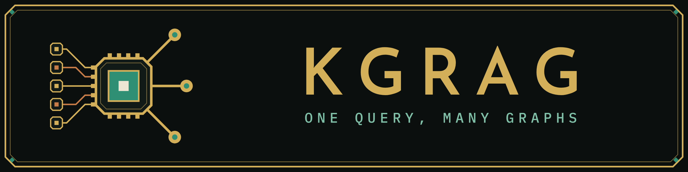
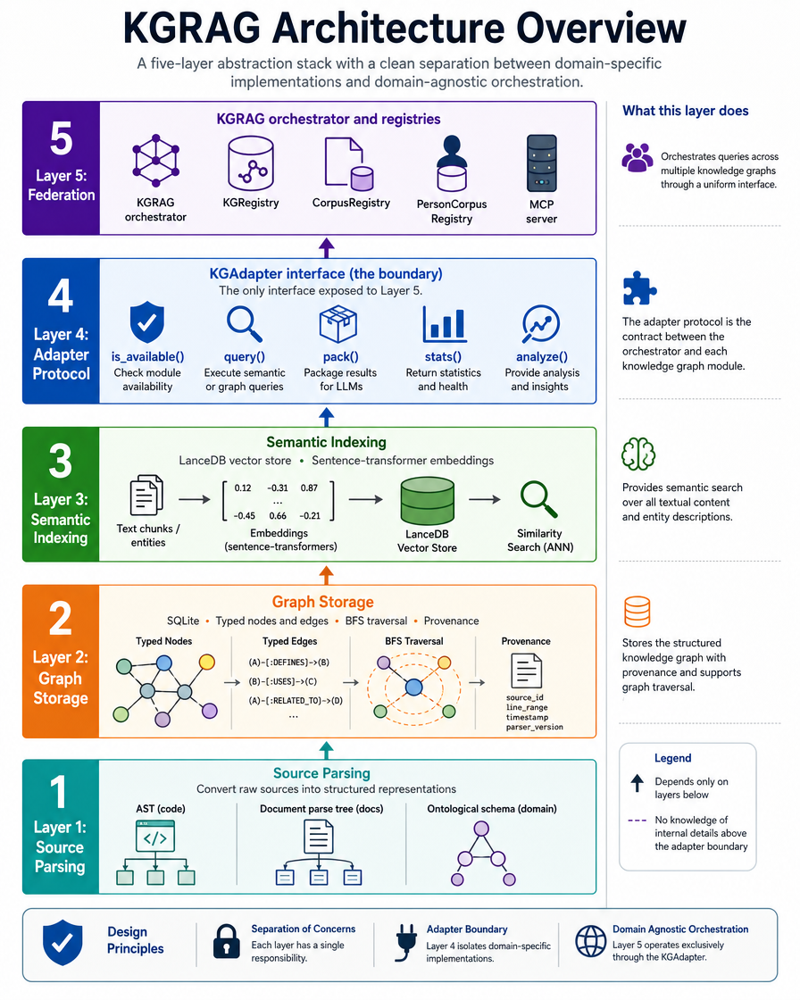

[](https://www.python.org/)
[](https://www.elastic.co/licensing/elastic-license)
[](https://github.com/Flux-Frontiers/KGRAG/releases)
[](https://github.com/Flux-Frontiers/KGRAG/actions/workflows/ci.yml)
[](https://python-poetry.org/)
[](https://doi.org/10.5281/zenodo.20018524)

<p align="center">
  
</p>

**KGRAG** -- Knowledge Compiler and Federated Retrieval Layer for Ontologically Grounded Domains

*Author: Eric G. Suchanek, PhD | Flux-Frontiers, Liberty TWP, OH*

---

## Overview

<p align="center">
  
</p>

KGRAG is a **federation and orchestration layer** for structural knowledge graphs derived from heterogeneous source domains. It brings every backend in the KGRAG fleet under a **single five-method adapter protocol**: Python and TypeScript and Swift code, documents, Obsidian vaults, metabolic pathways, diaries, episodic and conversational memory, file system trees, book corpora, genealogies and a fly-brain connectome. [KG Types](#kg-types) lists them all.

KGRAG treats **derived structure as ground truth** and uses **semantic embeddings strictly as an acceleration layer** for locating entry points into that structure. All graph traversal, ranking, and snippet extraction is deterministic. When KGRAG output is passed to a language model for synthesis, the model receives verified facts with full source provenance, not approximate embeddings.

**How this differs from RAG and KG-RAG:**
RAG embeds text chunks and retrieves by approximate similarity: no structure, no provenance. KG-RAG (GraphRAG, LlamaIndex KG) uses an LLM to extract entities and edges from text: the graph is inferred, inheriting the extractor's hallucinations. KGRAG derives its graphs from **formal source structure** -- ASTs for code, parse trees for prose, reaction schemas for biochemistry -- with no language model in the pipeline. The graph is correct by construction. Embeddings are disposable; the graph is not. The retrieval layer **cannot** hallucinate.

-> [Technical paper](articles/kgrag.pdf) | [Manifesto](docs/MANIFESTO.md)

---

## What's new

**0.19.2 (2026-11-23)**

- **Security: kgmodule-utils 0.30.2 is the floor** for the base install and
  `kg-rag[ingest]`. Before 0.30.2, the default oMLX synthesis backend sent
  `OPENAI_API_KEY` to the oMLX server when `VLLM_API_KEY` was unset.

**0.19.1 (2026-11-23)**

- **Security: imagewright 0.2.0 is the floor** for `kg-rag[imagine]`,
  `[imagine-local]` and `[all]`. imagewright 0.1.0 printed the OpenAI API key
  in a resolved config's repr.

**0.19.0 (2026-11-22)**

- **Images from your knowledge graphs.** `kgrag imagine` renders an image
  from a prompt, or from passages retrieved across the registered KGs and
  rewritten into a scene by a text model. Prose hits (documents, books,
  diaries) and non-prose hits (code, memory, connectomes) get different
  rewrite prompts. See [Image generation](#image-generation).
- **Four ways to render**, through
  [imagewright](https://github.com/Flux-Frontiers/imagewright): an image
  server, FLUX.2 Klein in process with no server at all, a LAN worker, or
  OpenAI. `pip install "kg-rag[imagine]"`; add `imagine-local` for in-process
  FLUX on Apple Silicon.
- **`kg_imagine` MCP tool.** The same flow for an agent: it returns the image
  to the MCP client. `kgrag-mcp` now serves 25 tools.
- **The KGRAG owl** shows what the pipeline is doing in the dashboard's
  Synthesize tab: waiting, retrieving, answering, done.
- **A new logo**, the federation fan, in the fleet's Art Techno style.

Earlier releases: [CHANGELOG.md](https://github.com/Flux-Frontiers/KGRAG/blob/main/CHANGELOG.md).

---

## KG Types

### Fully implemented

| Kind | Backend | Description |
|------|---------|-------------|
| `code` | PyCodeKG | Python codebase -- AST-extracted modules, classes, functions, call graphs |
| `doc` | DocKG | Document corpus -- Markdown/RST/text indexed by topic, section, and entity |
| `meta` | MetaboKG | Metabolic pathways -- biochemical reaction networks (KEGG, BioCyc) |
| `diary` | DiaryKG | Personal diary entries -- timestamped chunk graphs with temporal edges *(diary-kg; `kg-rag[diary]`)* |
| `agent` | AgentKG | Conversational memory -- Turn/Topic/Task/Summary graph (live session) |
| `filetree` | FTreeKG | File system tree -- directory/file/module/dependency structure *(ftree-kg; `kg-rag[filetree]`)* |
| `memory` | MemoryKG | Episodic memory -- hybrid semantic + structural graph for conversation/event corpora |
| `gutenberg` | GutenbergKG | Project Gutenberg book corpus -- literature indexed by author, genre, and chapter via DocKG-compatible indices |
| `genealogy` | GenealogyKG | Genealogical records -- person/family graph with relational edges *(genealogy-kg; install it alongside kg-rag, or the adapter reports unavailable)* |
| `connectome` | ConnectomeKG | Synapse-resolution connectome (FlyWire FAFB v783): neurons, cell types, neuropils and labels, searched by their descriptions *(connectome-kg; `kg-rag[connectome]`. Needs a store built with its vector index)* |
| `swift` | SwiftKG | Swift codebases -- classes, structs, protocols, extensions, methods, and their calls *(swift-kg)* |
| `typescript` | TypeScriptKG | TypeScript and JavaScript codebases -- modules, classes, functions, methods, and their calls *(tscode-kg)* |
| `vault` | VaultKG | Obsidian-style Markdown vaults -- notes, sections, tags, and the wikilinks, embeds and typed links (`supports:: [[X]]`) their authors wrote *(vault-kg; `kg-rag[vault]`)* |

### Stub adapters (protocol boundary, backends under development)

| Kind | Backend | Description |
|------|---------|-------------|
| `ia` | IABookKG | Internet Archive book corpus -- public-domain books indexed by genre and topic |
| `pdbfile` | -- | PDB structure files -- 3D atomic coordinates and protein metadata |
| `disulfide` | -- | Disulfide bond data -- cysteine connectivity in protein structures |
| `verse` | -- | Scripture/verse -- Book -> Chapter -> Verse hierarchy and cross-references |
| `person` | -- | Personal knowledge -- biographical and relational graphs |
| `legal` | -- | Legal corpus -- statutory codes and regulations *(TBD)* |

### Corpus abstractions

**Generic Corpus** -- A named collection of any KG instances grouped for scoped federated queries. Useful for project-level or thematic groupings (for example, `"KGRAG_repos"` combining code + doc KGs).

**Person Corpus** -- A corpus enriched with personal metadata representing an individual. Aggregates all KGs relevant to a person -- diaries, memories, documents, agent sessions, and more -- alongside structured personal data (birth year, address, email, contact info).

---

## Features

- **Document ingestion** -- `kgrag ingest` turns loose PDFs, Word documents, EPUBs, spreadsheets, slide decks and Markdown into a staged corpus, builds a KG over it, and registers the result in one command
- **Repo setup** -- `kgrag init` detects the code and doc layers a repository needs, builds them, and registers them; `kgrag scan` finds KGs already built under a directory tree
- **Multi-domain federation** -- Query code, docs, metabolic pathways, diary entries, and conversation history simultaneously
- **Timeline queries** -- `kgrag timeline` orders federated hits by date instead of relevance, with `--from`/`--to` at any ISO precision; undated hits are counted, not dropped
- **Answer synthesis** -- `kgrag synthesize` retrieves KG context and answers through a local Ollama server or any OpenAI-compatible one (omlx, LM Studio, vLLM)
- **Image generation** -- `kgrag imagine` renders an image from a prompt, or from passages retrieved across the registered KGs and rewritten into a scene by a text model; it renders on an image server, in process with FLUX, on a LAN worker or with OpenAI. The `kg_imagine` MCP tool does the same for an agent
- **Five-method adapter protocol** -- `is_available`, `query`, `pack`, `stats`, `analyze`; add a new domain by implementing five methods
- **Unified registry** -- Persistent SQLite-backed storage of KG locations, metadata, corpora, and person records
- **Corpus abstraction** -- Group KGs into named corpora for scoped federated queries
- **Person corpus** -- Model individuals with personal metadata and their associated KG collections
- **Hybrid querying** -- Semantic seeding via sqlite-vec (legacy LanceDB stores still readable) + structural BFS traversal
- **Context packing** -- Extract source-grounded snippets with line numbers for direct LLM ingestion
- **Portable KGs** -- `kgrag export` writes a registered KG to a `.kgrag.tar.gz` archive; `kgrag import` registers one on another machine
- **Health checks** -- `kgrag health` inspects every registered KG and corpus for common problems and suggests a fix command for each; `--fix` repairs the ones it can
- **MCP server** -- the fleet's five canonical tools across every registered KG, plus registry, corpus and person tools and `kg_imagine` (25 in all), for any MCP-compatible agent
- **CLI tooling** -- Full CRUD for KGs, corpora, and person corpora; query, pack, analyze, synthesize
- **Streamlit dashboard** -- `kgrag viz` opens Registry, Federated Query, Analysis, Snippet Pack and Synthesize tabs. In Synthesize, the KGRAG owl shows each stage as it runs: waiting, retrieving, answering, and done with the snippet and KG counts behind the answer
- **Qt viewer** -- `kgrag viz2d` draws one tile per registered KG in a split-viewport window
- **Deterministic retrieval** -- Auditable, source-grounded results; zero hallucination at the knowledge layer

---

## Quick start

```bash
pip install kg-rag

# With Streamlit dashboard
pip install 'kg-rag[viz]'

# With the 2-D Qt viewer (kgrag viz2d)
pip install 'kg-rag[viz2d]'

# With the common adapter backends (PyCodeKG, DocKG, MemoryKG).
# DocKG also backs every GutenbergKG corpus, which queries through it.
pip install 'kg-rag[kg]'

# DiaryKG, FileTreeKG, ConnectomeKG and VaultKG back kinds most registries
# never hold, so they have their own extras rather than riding along with [kg].
pip install 'kg-rag[diary]'
pip install 'kg-rag[filetree]'
pip install 'kg-rag[connectome]'
pip install 'kg-rag[vault]'

# With multi-format document ingestion (PDF, Word, PowerPoint, Excel, EPUB, ...)
pip install 'kg-rag[ingest]'

# With image generation (kgrag imagine, kg_imagine), and with in-process
# FLUX on Apple Silicon as well
pip install 'kg-rag[imagine]'
pip install 'kg-rag[imagine,imagine-local]'

# Every extra except imagine-local
pip install 'kg-rag[all]'
```

```bash
# Ingest a folder of mixed-format documents: convert -> build -> register
kgrag ingest ~/Documents/specs --into ~/corpora/specs

# Build and register the code and doc KGs for a repository
kgrag init /path/to/my-repo

# Register a KG you built yourself
kgrag register my-code code /path/to/my-repo

# Federated query across all registered KGs
kgrag query "authentication flow"

# The same search, ordered by date
kgrag timeline "manifold work" --from 2026-04

# Snippet pack for LLM ingestion
kgrag pack "database connection setup" --out context.md

# Answer a question from KG context with a local model (Ollama by default)
kgrag synthesize "How does the registry store corpora?"

# Picture what the KGs say about a topic
kgrag imagine --query "the great fire of London"

# Check every registered KG and corpus
kgrag health

# Launch the dashboard
kgrag viz
```

-> [Full installation guide](docs/INSTALLATION.md) | [Usage guide](docs/USAGE.md) | [CLI reference](docs/CLI_REFERENCE.md)

---

## Image generation

`kgrag imagine` generates a PNG from a prompt, or from passages retrieved
across the registered KGs. It needs no `gutenberg_kg`; the image client is
the fleet's `imagewright` package.

```bash
# Render a prompt as given
kgrag imagine "a lighthouse in a storm, oil painting"

# Retrieve passages, rewrite them into a scene, render
kgrag imagine --query "the great fire of London" -o fire.png

# The same, scoped to a corpus, with PROMPT added as style notes
kgrag imagine "woodcut" --query "the great fire" --corpus diaries

# Show the passages and the rewritten prompt without rendering
kgrag imagine --query "registry schema" --kind code --context-only
```

With `--query`, the top passages (`-k`, `--kind`, `--corpus`, as in
`kgrag synthesize`) are joined, capped at 800 characters, and rewritten
into an image prompt by the text model that `SYNTH_BACKEND`,
`SYNTH_ENDPOINT` and `SYNTH_MODEL` configure. When the top passage comes
from a `doc`, `gutenberg` or `diary` KG, the rewrite uses the prompt for
historical prose; any other kind uses a prompt for code and technical
records. If the rewrite fails, the command warns and renders the raw
passages. `--no-rewrite` skips the text model, and `--context-only` prints
the passages and the rewritten prompt and exits.

The image renders in one of four ways. Without `--backend`, `--endpoint` or
`--worker`, the command takes the first that applies, in this order:
`IMAGE_BACKEND` and `IMAGE_ENDPOINT`, a server answering on
`localhost:8090` or `localhost:8091`, then in-process FLUX (with a warning)
if it is installed. If none applies, it prints the ways to fix that.

| Way | How to choose it | Needs |
|---|---|---|
| An image server | `--endpoint URL`, `IMAGE_ENDPOINT`, or found on `localhost:8090`/`8091` | A server such as `imagewright serve` |
| In-process FLUX | `--backend mflux-local`, or no server found | `kg-rag[imagine-local]`, Apple Silicon; the first run downloads the weights |
| A LAN worker | `--worker URL` | A worker that serves `op: imagine`; its secret in `HANDLER_SECRET` |
| OpenAI | `--backend openai` | `OPENAI_API_KEY`; the prompt leaves the machine and the call is billed |

`--worker` sends both the rewrite and the render to the worker and cannot
be combined with `--backend` or `--endpoint`. `--size WxH` (default
`1536x1024`), `--seed` and `--steps` set the render; OpenAI ignores
`--size`, and the worker takes no seed, so `--seed` is ignored there with a
warning. The image is written to `-o PATH`, or to
`imagine_YYYYMMDD_HHMMSS.png` in the current directory, and opened in the
default viewer unless `--no-open` is given.

Two extras arrive with this release. `kg-rag[imagine]` installs
`imagewright` and the text-model client (`kgmodule-utils[synthesis]`), and
is part of `kg-rag[all]`. `kg-rag[imagine-local]` installs `imagewright`
and `mflux` for in-process FLUX on Apple Silicon. It is not part of `all`,
so install it with the first: `pip install 'kg-rag[imagine,imagine-local]'`.
Without `imagewright`, `kgrag imagine` stops with a line naming
`pip install "kg-rag[imagine]"`; the rest of `kgrag` is unaffected. Where
an `imagewright` message names `imagewright[flux]` or `imagewright[openai]`,
the command adds a line naming `kg-rag[imagine-local]`.

### From an agent: `kg_imagine`

The MCP server's `kg_imagine` tool runs the same flow and returns the image
to the agent, encoded to fit the client's 5 MB image limit: PNG when it
fits, else JPEG, else a smaller JPEG. It takes `prompt`, `query`, `corpus`,
`kinds`, `k` (1-100, default 8), `size` (default `1536x1024`), `seed` and
`steps` (1-50). A prompt is at most 4000 characters and a query at most
2000; out-of-range arguments are rejected, not clamped.

The tool has no backend, endpoint or worker arguments. The server's
environment chooses, in the same order as the command: `IMAGE_BACKEND` and
`IMAGE_ENDPOINT`, a server on `localhost:8090` or `localhost:8091`, then
in-process FLUX. The rewrite uses the `SYNTH_*` text model from the same
environment. The server keeps one image client, so in-process FLUX loads
once per server process. Warnings, such as a failed rewrite, and the final
prompt reach the client as log messages. `kgrag-mcp` starts without the
`imagine` extra; only `kg_imagine` then fails, naming
`pip install "kg-rag[imagine]"`.

---

## MCP integration

KGRAG ships a built-in MCP server, on the fleet's shared base `kg_utils.mcp`, for any MCP-compatible agent (Claude Code, Cursor, GitHub Copilot, Claude Desktop):

```bash
kgrag mcp
```

```json
{
  "mcpServers": {
    "kgrag": {
      "command": "kgrag",
      "args": ["mcp"]
    }
  }
}
```

It answers the fleet's five canonical tools (`stats`, `query`, `pack`, `get_node`, `neighbors`) across every registered KG, with node ids of the form `<kg>::<node id>`, plus `list_kgs` and `kg_info`, 8 corpus tools, 9 person-corpus tools and `kg_imagine`: 25 in all. `kgrag mcp --manifest` prints them.

-> [Full MCP reference](docs/MCP.md)

---

## Documentation

| Document | Description |
|----------|-------------|
| [Technical Paper](articles/kgrag.pdf) | Architecture, design principles, and formal treatment |
| [Manifesto](docs/MANIFESTO.md) | The case for Structurally-Grounded Synthetic Intelligence |
| [Installation Guide](docs/INSTALLATION.md) | Prerequisites, venv setup, extras |
| [Usage Guide](docs/USAGE.md) | Workflows, patterns, and examples |
| [CLI Reference](docs/CLI_REFERENCE.md) | Complete command reference |
| [Ingestion Pipeline](docs/INGESTION.md) | Converting loose documents into a registered KG -- converters, staging, manifest |
| [MCP Reference](docs/MCP.md) | Tool reference and agent configuration |
| [Adapter Spec](docs/ADAPTER_SPEC.md) | Five-method protocol for new backends |
| [Troubleshooting](docs/TROUBLESHOOTING.md) | Common issues and fixes |
| [Fleet Versions](docs/FLEET_VERSIONS.md) | Generated version & constraint state across the KG fleet |

---

## Related projects

| Project | Description |
|---------|-------------|
| [PyCodeKG](https://github.com/Flux-Frontiers/pycode_kg) | Deterministic knowledge graph for Python codebases |
| [DocKG](https://github.com/Flux-Frontiers/doc_kg) | Semantic knowledge graph for document corpora |
| [MetaboKG](https://github.com/Flux-Frontiers/metabo_kg) | Metabolic pathway knowledge graph |
| [DiaryKG](https://github.com/Flux-Frontiers/diary_kg) | Diary and personal journal corpus knowledge graph |
| [AgentKG](https://github.com/Flux-Frontiers/agent_kg) | Conversational memory knowledge graph |
| [FTreeKG](https://github.com/Flux-Frontiers/ftree_kg) | File system tree knowledge graph |
| [MemoryKG](https://github.com/Flux-Frontiers/memory_kg) | Episodic memory knowledge graph for conversation and event corpora |
| [GutenbergKG](https://github.com/Flux-Frontiers/gutenberg_kg) | Project Gutenberg book corpus knowledge graph |
| [GenealogyKG](https://github.com/Flux-Frontiers/genealogy_kg) | Genealogy knowledge graph built from GEDCOM files |
| [ConnectomeKG](https://github.com/Flux-Frontiers/connectome_kg) | Knowledge graph of the FlyWire FAFB v783 fly-brain connectome |
| [SwiftKG](https://github.com/Flux-Frontiers/swift_kg) | Knowledge graph for Swift codebases |
| [TypeScriptKG](https://github.com/Flux-Frontiers/tscode_kg) | Knowledge graph for TypeScript and JavaScript codebases |
| [VaultKG](https://github.com/Flux-Frontiers/vault_kg) | Knowledge graph of an Obsidian-style Markdown vault |
| [kgmodule-utils](https://github.com/Flux-Frontiers/KG_utils) | Shared SDK for the fleet: the `KGModule` base, MCP server base, ingestion and temporal helpers |
| IABookKG *(coming soon)* | Internet Archive book corpus knowledge graph |

---

## License

[Elastic License 2.0](https://www.elastic.co/licensing/elastic-license) -- see [LICENSE](LICENSE).

Free to use, modify, and distribute. You may not offer the software as a hosted or managed service to third parties. Commercial internal use is permitted.

*The Knowledge Compiler concept and its execution are the subject of a pending U.S. provisional patent application.*

---

## Citation

If you use KGRAG in your research or project, please cite it:

[](https://doi.org/10.5281/zenodo.20018524)

> Suchanek, E. G. (2026). *KGRAG: Knowledge Compiler and Federated Retrieval Layer* (Version 0.19.2) [Software]. Flux-Frontiers. https://doi.org/10.5281/zenodo.20018524

```bibtex
@software{suchanek_kgrag,
  author    = {Suchanek, Eric G.},
  title     = {{KGRAG}: Knowledge Compiler and Federated Retrieval Layer},
  version   = {0.19.2},
  year      = {2026},
  publisher = {Flux-Frontiers},
  url       = {https://github.com/Flux-Frontiers/KGRAG},
  doi       = {10.5281/zenodo.20018524},
}
```

---
